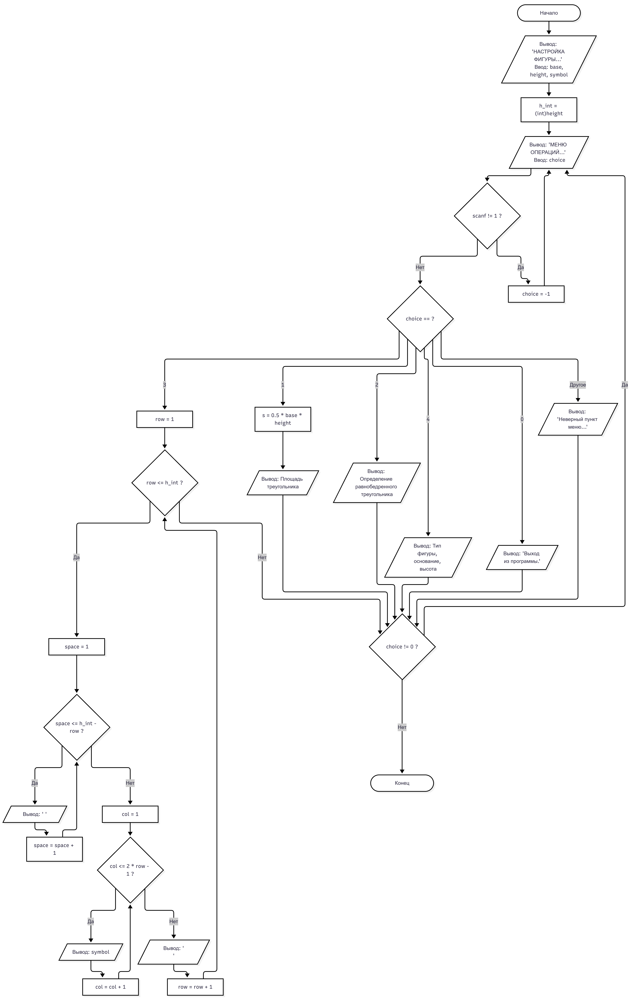

# Лабораторная работа № 10
## 1. Условие задачи, 6 Вариант
.png) 

 

## 2. Реализация программы
```
#define _CRT_SECURE_NO_WARNINGS
#include <stdio.h>
#include <windows.h> // не работает #include <locale.h>


float area_triangle(float base, float height);
void print_definition_triangle();
void draw_triangle(int h, char symbol);
void print_parameters(float base, float height);


int main(void)
{
    SetConsoleOutputCP(65001);
    float base;
    float height;
    int h_int;
    char symbol;
    int choice;

    printf("НАСТРОЙКА ФИГУРЫ (Равнобедренный треугольник)\n");
    printf("Введите основание треугольника (base): ");
    scanf("%f", &base);
    printf("Введите высоту треугольника (height/h): ");
    scanf("%f", &height);

    h_int = (int)height;
    printf("Введите символ для рисования (например, *): ");
    scanf(" %c", &symbol);

    do {
        printf("\nМЕНЮ ОПЕРАЦИЙ\n");
        printf("1. Рассчитать площадь\n");
        printf("2. Вывести определение фигуры\n");
        printf("3. Нарисовать фигуру\n");
        printf("4. Вывести параметры фигуры\n");
        printf("0. Выход\n");
        printf("Выберите операцию: ");

        if (scanf("%d", &choice) != 1) {
            printf("Ошибка ввода!\n");
            while (getchar() != '\n');
            choice = -1;
            continue;
        }

        switch (choice) {
        case 1:
            printf("\nПлощадь треугольника: %.2f\n", area_triangle(base, height));
            break;
        case 2:
            print_definition_triangle();
            break;
        case 3:
            printf("\n");
            draw_triangle(h_int, symbol);
            printf("\n");
            break;
        case 4:
            print_parameters(base, height);
            break;
        case 0:
            printf("\nВыход из программы.\n");
            break;
        default:
            printf("Неверный пункт меню. Попробуйте снова.\n");
        }
    } while (choice != 0);

    system("pause");
    return 0;
}


float area_triangle(float base, float height)
{
    float s;

    s = 0.5f * base * height;
    return s;
}

void print_definition_triangle()
{
    printf("\nОПРЕДЕЛЕНИЕ\n");
    printf("Равнобедренный треугольник — это треугольник, в котором две стороны равны между собой.\n");
    printf("Углы при основании равнобедренного треугольника равны.\n");
}

void draw_triangle(int h, char symbol)
{
    int row, space, col;


    for (row = 1; row <= h; row = row + 1)
    {
        for (space = 1; space <= h - row; space = space + 1)
        {
            printf(" ");
        }
        for (col = 1; col <= (2 * row - 1); col = col + 1)
        {
            printf("%c", symbol);
        }
        printf("\n");
    }
}


void print_parameters(float base, float height)
{
    printf("\nПАРАМЕТРЫ ФИГУРЫ\n");
    printf("Тип фигуры: Равнобедренный треугольник\n");
    printf("Основание: %.2f\n", base);
    printf("Высота: %.2f\n", height);
}
```

## 3. Результаты работы программы
```
НАСТРОЙКА ФИГУРЫ (Равнобедренный треугольник)
Введите основание треугольника (base): 5
Введите высоту треугольника (height/h): 6
Введите символ для рисования (например, *): *

МЕНЮ ОПЕРАЦИЙ
1. Рассчитать площадь
2. Вывести определение фигуры
3. Нарисовать фигуру
4. Вывести параметры фигуры
0. Выход
Выберите операцию: 1

Площадь треугольника: 15.00

МЕНЮ ОПЕРАЦИЙ
1. Рассчитать площадь
2. Вывести определение фигуры
3. Нарисовать фигуру
4. Вывести параметры фигуры
0. Выход
Выберите операцию: 2

ОПРЕДЕЛЕНИЕ
Равнобедренный треугольник — это треугольник, в котором две стороны равны между собой.
Углы при основании равнобедренного треугольника равны.

МЕНЮ ОПЕРАЦИЙ
1. Рассчитать площадь
2. Вывести определение фигуры
3. Нарисовать фигуру
4. Вывести параметры фигуры
0. Выход
Выберите операцию: 3

     *
    ***
   *****
  *******
 *********
***********


МЕНЮ ОПЕРАЦИЙ
1. Рассчитать площадь
2. Вывести определение фигуры
3. Нарисовать фигуру
4. Вывести параметры фигуры
0. Выход
Выберите операцию: 4

ПАРАМЕТРЫ ФИГУРЫ
Тип фигуры: Равнобедренный треугольник
Основание: 5.00
Высота: 6.00

МЕНЮ ОПЕРАЦИЙ
1. Рассчитать площадь
2. Вывести определение фигуры
3. Нарисовать фигуру
4. Вывести параметры фигуры
0. Выход
Выберите операцию: 0

Выход из программы.
Press any key to continue . . .
```

## 4. Информация о разработчике

 Воропаева Дарья БИД-261
